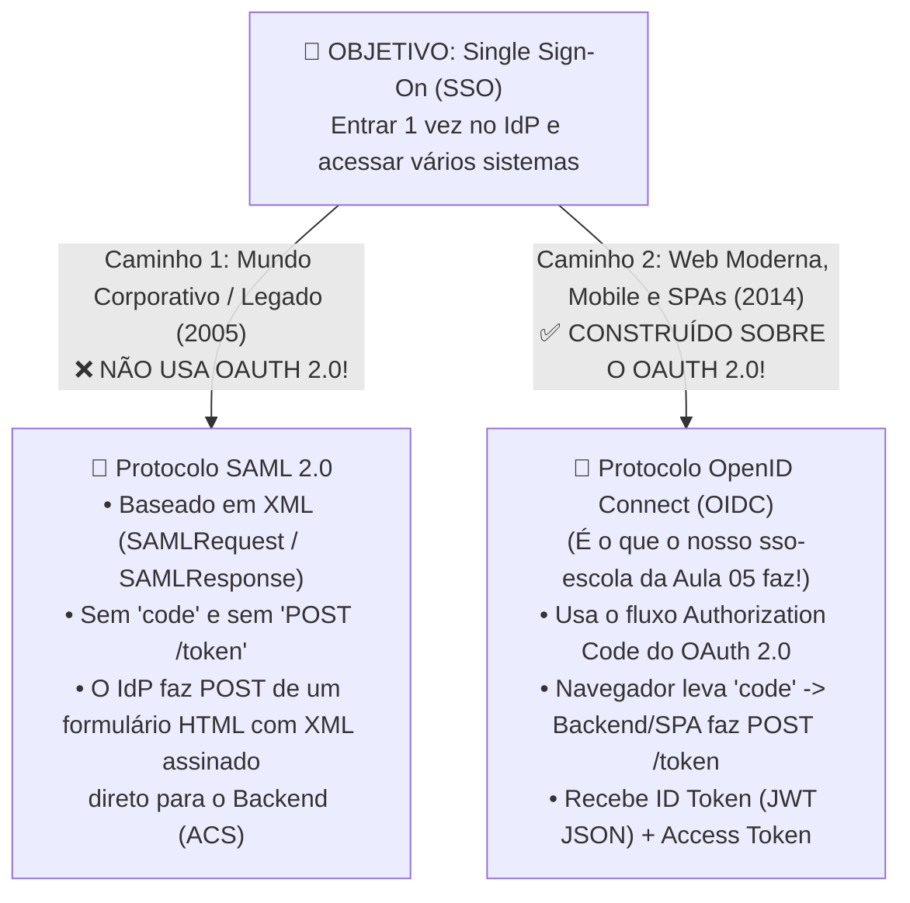
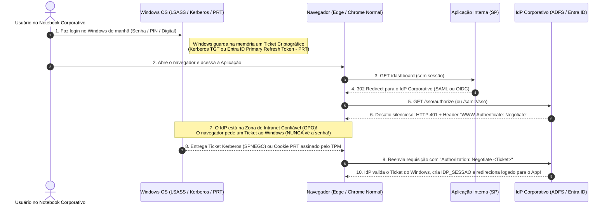

# Aula 05 — Single Sign-On (SSO) & OpenID Connect (OIDC)

**Prof. Wenceslau Neto · Ada Tech · Fundamentos de Segurança para Aplicações (BE-JV-013)**

---

## Slide 1 — 1. O que é Single Sign-On (SSO) — e o que NÃO é

> 🎬 **Imagine o cenário:** Uma empresa tem **20 sistemas internos** (e-mail, folha de pagamento, Git, wiki, chamados). Cada um tem seu próprio login e senha. Na segunda-feira, metade dos chamados no suporte é *"esqueci a senha"*. Quando alguém é desligado da empresa, o TI precisa lembrar de bloquear o acesso em 20 lugares diferentes!

### O que é o Single Sign-On (Login Único)?

- Forma de autenticação em que o usuário acessa **vários sistemas independentes** autenticando-se **uma única vez** com um único conjunto de credenciais.
- ⚠️ **A Confusão Mais Comum: SSO NÃO é "usar a mesma senha em todo lugar"!**
  - **Mesma senha em 20 sistemas:** Você digita a senha 20 vezes e **todos os 20 sistemas guardam a sua senha** (se 1 sistema vazar, todos vazam).
  - **Single Sign-On (SSO):** Você digita a senha **uma única vez**, em **um único lugar central (IdP)**, e os outros 19 sistemas **nunca veem a sua senha**!

### Identidade Federada e os 3 Componentes

| Componente | O que é | Exemplos |
| --- | --- | --- |
| **1. Provedor de Identidade (IdP — *Identity Provider*)** | O único lugar que guarda as credenciais, autentica o usuário de fato e responde *"esta pessoa é fulano"* | Keycloak, Microsoft Entra ID, Okta, Google |
| **2. Aplicação (SP — *Service Provider* / *Relying Party*)** | O sistema que o usuário quer acessar e que **confia** na resposta do IdP | Sistema de Notas, Biblioteca, Gmail |
| **3. Relação de Confiança (*Trust Relationship*)** | O acordo configurado antes do 1º login (chaves públicas RSA, certificados e URLs de callback permitidas) | `application-idp.yml` + Chave Pública RSA |

---

## Slide 2 — 1. Como o Fluxo SSO Funciona (O Ganho Vem no 2º Sistema!)

### Passo a Passo no 1º Sistema (`App A — Notas`)

```text
1. Usuário pede um recurso no App A (/minhas-notas)
2. App A vê que não há sessão local e REDIRECIONA (302) o navegador ao IdP
3. O IdP vê que não há sessão ativa -> mostra a tela de login (a senha é digitada AQUI!)
4. O IdP valida a senha (BCrypt) e cria a sessão global no domínio dele (IDP_SESSAO)
5. O IdP devolve um código de uso único -> o App A troca pela comprovação assinada (RS256)
6. O App A verifica a assinatura com a chave pública do IdP e cria sua sessão local (NOTAS_SESSAO)
```

### A Mágica no 2º Sistema (`App B — Biblioteca`)

```text
1º Acesso: Usuário -> Notas      -> (redireciona) -> IdP (pede senha e cria IDP_SESSAO) -> Notas (logado!)
2º Acesso: Usuário -> Biblioteca -> (redireciona) -> IdP (JÁ TEM IDP_SESSAO!)           -> Biblioteca (logado SEM digitar nada!)
```

- **Atenção:** No 2º sistema, **o redirecionamento ao IdP continua acontecendo**, mas como o navegador envia o cookie `IDP_SESSAO` que já estava ativo no IdP, o IdP emite o código imediatamente sem mostrar a tela de senha!

---

## Slide 3 — 2. O SSO Rodando na Sua Máquina: Projeto `sso-escola` (`aula05`)

No módulo `aula05`, executamos **o mesmo projeto Spring Boot 3 vezes** simultaneamente, mudando apenas o perfil (`--spring.profiles.active`):

| Processo | Papel no SSO | Endereço no Navegador | Perfil | Cookie de Sessão |
| --- | --- | --- | --- | --- |
| **Login Único da Escola** | **Provedor de Identidade (IdP)** — único com senhas (`BCrypt`) e **Chave Privada RSA** | `http://idp.localhost:9000` | `idp` | `IDP_SESSAO` |
| **Sistema de Notas** | **Aplicação (SP 1)** — sem senhas; valida com a **Chave Pública RSA** do IdP | `http://notas.localhost:8081` | `notas` | `NOTAS_SESSAO` |
| **Sistema da Biblioteca** | **Aplicação (SP 2)** — sem senhas; valida com a **Chave Pública RSA** do IdP | `http://biblioteca.localhost:8082` | `biblioteca` | `BIBLIOTECA_SESSAO` |

> 💡 **Por que usamos `notas.localhost:8081` e não `localhost:8081`?**
>
> Os navegadores isolam cookies por **nome de host (domínio)**, e **NÃO por porta**! Se os três sistemas rodassem em `localhost`, todos compartilhariam o mesmo jarro de cookies. Com `idp.localhost`, `notas.localhost` e `biblioteca.localhost`, cada sistema se comporta como um site independente!

---

## Slide 4 — 2. Fluxo Completo do `sso-escola` nos Bastidores

```text
Navegador                    Notas (SP :8081)                  Login Único (IdP :9000)
    | 1. GET /minhas-notas          |                                    |
    |------------------------------>|                                    |
    | 2. 302 -> idp.localhost:9000/sso/autorizar?app=notas&state=XYZ     |
    |<------------------------------| (guarda state na sessão)           |
    | GET /sso/autorizar?app=notas&state=XYZ                             |
    |------------------------------------------------------------------->|
    |                               |  3. Sem IDP_SESSAO: mostra login   |
    |                               |  4. Valida BCrypt e cria IDP_SESSAO|
    | 5. 302 -> notas.localhost:8081/sso/callback?code=ABC&state=XYZ     |
    |<-------------------------------------------------------------------|
    | GET /sso/callback?code=ABC&state=XYZ                               |
    |------------------------------>|                                    |
    |                               | 6a. Confere state (anti-CSRF)      |
    |                               | POST /sso/token (code + Basic id:segredo)
    |                               |----------------------------------->|
    |                               |<-----------------------------------| {"assercao": "<JWT RS256>"}
    |                               | 6b. Valida assinatura RSA, iss, aud, exp
    |                               | 6c. Cria sessão local (NOTAS_SESSAO)
    | 302 -> /minhas-notas          |                                    |
    |<------------------------------|                                    |
```

---

## Slide 5 — 2. Por Dentro da Asserção: `RS256`, `aud` e Autorização Local

### 🔐 1. `RS256` em Ação (`AsercaoService.java` × `VerificadorDeAsercao.java`)

- **No IdP (Assinatura com Chave Privada RSA):**
  - Gera um JWT contendo `iss` (`http://idp.localhost:9000`), `sub` (`carlos`), `aud` (`notas`), `uso` (`login`), `nome`, `email`, `papel` (`PROFESSOR`).
- **Nas Aplicações (Verificação com Chave Pública RSA):**
  - `JWT.require(Algorithm.RSA256(chavePublica, null)).withIssuer(...).withAudience(props.id()).withClaim("uso", "login")`
  - Fixa o algoritmo `RS256` (bloqueando `alg: none` e `HS256`) e garante que **nenhuma aplicação consiga forjar tokens**!

### 🎯 2. Por que a claim `aud` (*Audience*) é vital?

- Se um atacante pegar uma asserção emitida para a **`biblioteca`** (`"aud": "biblioteca"`) e tentar enviá-la para as **`notas`**, o verificador das Notas rejeita na hora porque exige `"aud": "notas"`.

### ⚖️ 3. Identidade é Federada; Permissão é Local!

- O IdP autentica **QUEM é a pessoa** (`carlos`, `PROFESSOR`).
- **Cada sistema decide o que ela pode fazer:** nas `Notas`, `carlos` pode `/lancar-notas`; na `Biblioteca`, `/acervo/gerenciar` exige `BIBLIOTECARIO` (`marta`), então `carlos` recebe **403 Sem Permissão**!

---

## Slide 6 — 2. Single Logout (SLO) & Vantagens vs. Riscos do SSO

### 🚪 Sair de Um Sistema vs. Sair de Todos (*Single Logout*)

- **"Sair só deste sistema" (nas Notas):** Apaga apenas o cookie `NOTAS_SESSAO`. Se você abrir as Notas de novo, o navegador vai ao IdP, o IdP vê que `IDP_SESSAO` continua vivo e **te loga de novo automaticamente**!
- **"Sair de todos (login único)" (no IdP — *Back-Channel Logout*):**
  - O IdP destrói `IDP_SESSAO` e faz chamadas HTTP servidor-a-servidor (`POST /sso/logout-backchannel` enviando um `logout_token` assinado com `uso="logout"`) para avisar as `Notas` e a `Biblioteca`.
  - ⚠️ **Por que o Single Logout é difícil?** Se a `Biblioteca` estiver fora do ar no momento do aviso, ela não recebe a notificação e sua sessão local continua ativa até expirar!

### ⚖️ Vantagens × Riscos do SSO

| ✅ Vantagens do SSO | 🚨 Riscos do SSO (e como mitigar) |
| --- | --- |
| Menos senhas para lembrar (fim das senhas em post-it) | **Ponto Único de Falha (SPOF):** Se o IdP cair, ninguém **novo** entra (quem já tem sessão local continua) |
| **Desligamento imediato:** bloqueou no IdP, bloqueou nos 20 sistemas | **Alvo de Alto Valor:** Invadir a conta no IdP abre todos os 20 sistemas |
| As 20 aplicações **não guardam senhas** | **Single Logout complexo:** difícil garantir que todas as sessões locais caiam juntas |
| **MFA e políticas de segurança em 1 único ponto** | **Mitigação:** Investir pesado em **MFA, Rate Limit e Monitoramento** no IdP! |

---

## Slide 7 — 3. A Grande Dúvida: OAuth 2.0 vs. SSO com OIDC vs. SSO com SAML 2.0

> 🧭 **Regra fundamental para não confundir:**
> **SSO é o OBJETIVO** (logar 1 vez e entrar em vários sistemas). Para implementar SSO existem **duas famílias de protocolo completamente diferentes**: uma que **NÃO usa OAuth 2.0** (**SAML 2.0**) e outra que **NASCEU em cima do OAuth 2.0** (**OpenID Connect / OIDC**)!



### Quadro Comparativo: Os 3 Cenários Lado a Lado

| Pergunta / Critério | 1. OAuth 2.0 Puro (Aula 04) | 2. SSO com OIDC (`sso-escola` — Aula 05) | 3. SSO com SAML 2.0 (Mundo Corporativo) |
| :--- | :--- | :--- | :--- |
| **Qual é o objetivo principal?** | **Autorização delegada:** dar permissão a um app para chamar uma API em seu nome | **Autenticação + SSO moderno:** saber *quem é* o usuário e logá-lo em vários sistemas | **Autenticação + SSO corporativo:** logar funcionários em sistemas internos/B2B |
| **Usa o protocolo OAuth 2.0?** | **Sim (é o próprio OAuth 2.0)** | **Sim!** Usa o fluxo *Authorization Code* do OAuth 2.0 adicionando identidade (`scope=openid`) | **NÃO! Zero OAuth 2.0!** Tem seu próprio protocolo de mensagens desde 2005 |
| **Como a prova chega à aplicação?** | Redireciona com `?code=...` → troca no back-channel (`POST /token`) | Redireciona com `?code=...` → troca no back-channel (`POST /token` ou `/sso/token`) | **Sem `code`!** O IdP devolve um `<form method="POST">` automático enviando o XML para o backend (`POST /saml/acs`) |
| **O que vem dentro da resposta?** | Apenas **`access_token`** (para chamar a API de recursos) | **`id_token` (JWT)** (ou `assercao` no `sso-escola`) dizendo **quem é o usuário** + `access_token` | **`SAMLResponse` (Asserção em XML)** assinada com certificado X.509 (`XML-DSig`) |
| **Funciona direto numa SPA (Angular/React)?** | Sim (com `Authorization Code + PKCE`) | **Sim!** Nativo para SPAs, Mobile e Backends (JSON + REST + CORS) | **NÃO diretamente!** Uma SPA estática não recebe `POST` de formulário nem valida `XML-DSig` com segurança |

---

## Slide 8 — 3. Caso Real de Arquitetura: Como fazer SSO com SAML 2.0 quando o Frontend é uma SPA (Angular)?

> 🏗️ **Experiência Real de Projeto:**
> *"Se a empresa do cliente exige **SAML 2.0** (ex.: ADFS / Microsoft Entra ID corporativo), mas a minha aplicação moderna tem um **Frontend SPA (Angular)** e um **Backend (Spring Boot)**, como isso funciona se a SPA não consegue receber nem validar o XML do SAML?"*

```mermaid
sequenceDiagram
    autonumber
    actor U as Usuário (Navegador)
    participant SPA as Frontend SPA (Angular)
    participant BE as Backend Spring Boot (SAML SP)
    participant IDP as IdP Corporativo (SAML 2.0)

    U->>SPA: 1. Abre a SPA (não autenticado)
    SPA->>BE: 2. Redireciona navegador para /saml2/authenticate
    BE-->>U: 3. 302 Redirect para o IdP com SAMLRequest (XML Base64)
    U->>IDP: 4. Digita credenciais corporativas no IdP
    IDP-->>U: 5. Devolve HTML com <form method="POST" action=".../login/saml2/sso">
    Note over U,BE: ⚠️ O POST vai para o BACKEND (ACS), NUNCA para a SPA!
    U->>BE: 6. Navegador submete o POST automático com SAMLResponse (XML assinado)
    Note right of BE: 7. Backend valida assinatura XML-DSig (X.509)<br/>e extrai usuário/roles da Asserção SAML
    BE-->>U: 8. 302 Redirect de volta para a SPA (https://app.com/callback)<br/>propagando a sessão (Cookie HttpOnly ou Código/JWT próprio)
    U->>SPA: 9. SPA carrega autenticada e chama as APIs do Backend!
```



### Por que o Backend precisa intermediar o SAML para a SPA?
1. **Barreira de Transporte HTTP:** No SAML *HTTP POST Binding*, o IdP faz um `POST` de formulário (`application/x-www-form-urlencoded`) para a aplicação. Uma SPA em Angular (arquivos `.html`/`.js` servidos por Nginx/CDN) **não processa `POST` HTTP**.
2. **Barreira Criptográfica (`XML-DSig`):** Validar assinaturas digitais em XML canônico (`C14N`) e descriptografar asserções SAML exige bibliotecas pesadas de servidor e chaves privadas que não podem ficar no navegador.
3. **A Ponte Backend → SPA:** O Backend atua como o **Service Provider (SP) SAML**, valida o XML do IdP e, uma vez convencido de quem é o usuário, **emite a própria sessão para a SPA** (seja via **Cookie `HttpOnly` / BFF** ou emitindo um **JWT próprio da aplicação**)!

---

## Slide 9 — 3. Curiosidade Corporativa: "Como o SSO da empresa me loga no navegador usando o meu login do Windows sem pedir senha?"

> 🏢 **A Pergunta Clássica do Dia a Dia Corporativo:**
> *"Na empresa, eu ligo o notebook do trabalho, faço login no Windows, abro o Chrome/Edge e entro no sistema interno. Ele nem pede minha senha! Mas se eu abrir uma **aba anônima (Incognito)**, aí o IdP pede usuário e senha. Como o navegador descobre a minha sessão do Windows?"*



### Os 2 Mecanismos por Trás dessa "Mágica" (*Desktop Seamless SSO*)
1. **Intranet Corporativa / ADFS (`IWA — Integrated Windows Authentication` com Kerberos):**
   - Quando você entra no Windows, o Active Directory entrega ao sistema operacional um **TGT (*Ticket Granting Ticket*)** do protocolo **Kerberos**.
   - Quando o navegador é redirecionado ao IdP da empresa, o IdP envia o cabeçalho `WWW-Authenticate: Negotiate` (**SPNEGO**). Como o domínio do IdP está configurado como confiável na política da máquina (GPO), o navegador pede ao Windows um **Ticket Kerberos** específico para o IdP e o envia automaticamente no cabeçalho `Authorization: Negotiate ...`.
2. **Nuvem Moderna / Windows 10 e 11 (`Microsoft Entra ID / Azure AD` com `PRT`):**
   - Em máquinas modernas conectadas ao Entra ID, o Windows guarda um **PRT (*Primary Refresh Token*)** protegido pelo chip **TPM** da placa-mãe. O Edge e o Chrome conversam com o gerenciador de contas do Windows (*Web Account Manager*) e anexam um token criptográfico derivado desse PRT ao falar com `login.microsoftonline.com`.

### 🕵️‍♂️ E por que na Aba Anônima (*Incognito / InPrivate*) ele pede usuário e senha?
1. **Bloqueio Proposital da Integração com o Sistema Operacional:** Por privacidade (e para permitir que um desenvolvedor ou administrador consiga testar o sistema com **outra conta**), a aba anônima **desativa a resposta automática ao `WWW-Authenticate: Negotiate` (Kerberos) e bloqueia o acesso ao `PRT` do Windows**.
2. **Jarro de Cookies Vazio:** Além de não ter o cookie `IDP_SESSAO` da aba normal, como o navegador anônimo recusa o desafio silencioso do Windows, o IdP faz *fallback* e exibe a tela tradicional de login e MFA!

---

## Slide 10 — 4. OpenID Connect (OIDC): Quem é o Usuário?

O **OAuth 2.0** foi criado para **Autorização** (*"este app pode ler minhas fotos?"*), não para dizer quem é o usuário. O **OpenID Connect (OIDC)** adiciona uma **camada padronizada de Autenticação** em cima do OAuth 2.0!

| OAuth 2.0 Puro | OpenID Connect (OIDC = OAuth 2.0 + Identidade) |
| --- | --- |
| Entrega apenas o **Access Token** | Entrega o Access Token **E** o **ID Token** |
| Responde: *"Pode acessar tal recurso?"* | Responde: ***"QUEM é o usuário e quando ele se autenticou?"*** |
| Escopos da API (`fotos:leitura`) | Escopo obrigatório **`openid`** (+ `profile`, `email`) |
| Cada provedor inventava sua própria API de perfil | Formato **100% padronizado** (claims OIDC + rota `/userinfo`) |

### 🪪 A Regra de Ouro: `ID Token` vs. `Access Token`

- **`ID Token` (sempre um JWT):** Feito para o **Aplicativo Cliente (Relying Party) LER** e saber quem fez login (`sub`, `name`, `email`).
- **`Access Token`:** Feito para o cliente enviar à **API de Recursos (`Resource Server`)**. O cliente não deve tentar abrir o `Access Token` nem mandar o `ID Token` para chamar APIs de negócios!

---

## Slide 11 — 4. Anatomia do `ID Token`, Discovery e Fluxos do OIDC

### 🔍 Por Dentro de um `ID Token`

```json
{
  "iss": "https://accounts.exemplo.com",
  "sub": "248289761001",
  "aud": "meu-client-id",
  "exp": 1762876800,
  "iat": 1762873200,
  "nonce": "n-0S6_WzA2Mj",
  "name": "Ana Souza",
  "email": "ana@exemplo.com"
}
```

- **`sub` (*Subject*):** Identificador **único e imutável** do usuário no provedor (nunca use `email` como chave primária no seu banco, pois o usuário pode mudar de e-mail!).
- **`aud` (*Audience*):** O `client_id` do seu aplicativo (obriga você a validar que o token foi emitido para o seu app).
- **`nonce`:** String aleatória enviada pelo cliente no pedido de login e ecoada dentro do `ID Token` → **protege contra Replay Attacks**.
- **Descoberta Automática (*Discovery*):** O provedor publica todos os seus endpoints e o link das chaves públicas (`jwks_uri`) em **`/.well-known/openid-configuration`**.

### 🔄 Fluxos do OIDC: Authorization Code vs. Implicit (Legado)

- ✅ **Authorization Code (+ PKCE):** O navegador só recebe o `code`; o `id_token` e o `access_token` vêm na chamada direta servidor a servidor (`POST /token`).
- ❌ **Implicit Flow (Legado — Evitar):** Devolvia o `id_token` direto na **URL do navegador**, ficando exposto no histórico do browser, logs de rede, extensões e cabeçalho `Referer`!

---

## Slide 12 — 5. Como Tudo se Conecta (`sso-escola` ↔ OIDC + Projeto Final)

### 🪞 O `sso-escola` já é um OpenID Connect por dentro!

| No projeto `sso-escola` (`aula05`) | Nome Oficial no OpenID Connect (OIDC) |
| --- | --- |
| `GET /sso/autorizar?app=notas&state=XYZ` | `GET /authorize?client_id=notas&state=XYZ&scope=openid` |
| `POST /sso/token` com `Basic id:segredo` | `POST /token` com `client_id` + `client_secret` (ou PKCE) |
| `assercao` (JWT RS256 com `iss`, `sub`, `aud`, `nome`, `email`) | **`id_token`** |
| `GET /sso/chave-publica` | **`jwks_uri`** (descoberto via `/.well-known/openid-configuration`) |
| `logout_token` (`uso=logout`) | **OIDC Back-Channel Logout** (`logout_token`) |

### 🧩 Quadro-Resumo Definitivo do Módulo

| Conceito | O que é | Usa OAuth 2.0? | Pergunta que Responde |
| --- | --- | --- | --- |
| **JWT** | Um **formato** de token assinado com claims | Independente (usado em vários lugares) | *"Em que formato viaja a informação?"* |
| **OAuth 2.0** | Protocolo de **autorização** delegada (`access_token`) | É o próprio OAuth 2.0 | *"O que este portador pode acessar?"* |
| **SSO** | O **objetivo** de entrar 1 vez e acessar vários sistemas | Depende do protocolo escolhido (OIDC sim; SAML não) | *"Como evitar logins e senhas repetidas?"* |
| **SAML 2.0** | Protocolo de SSO com asserções em **XML** (`POST` para o backend) | **NÃO** | *"Como provar a autenticação (mundo corporativo/legado)?"* |
| **OpenID Connect** | Camada de **autenticação** sobre OAuth 2.0 (`id_token` em JWT) | **SIM** | ***"QUEM é o usuário?"*** |
