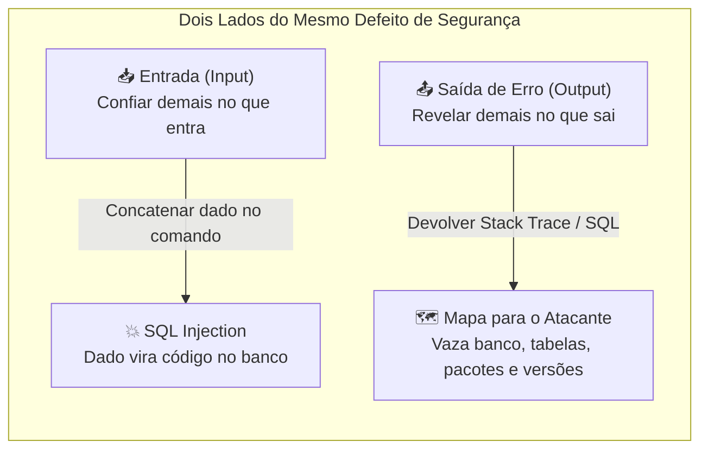
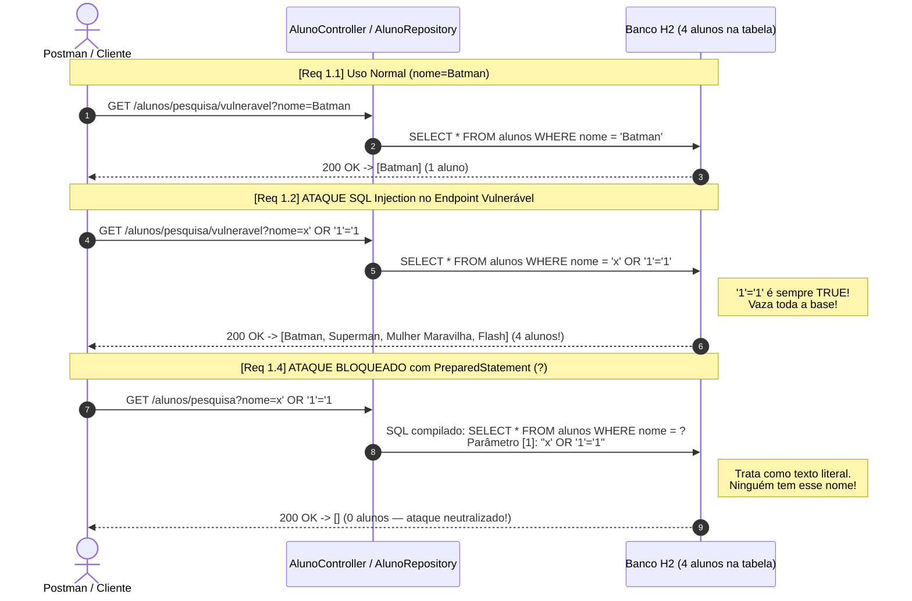
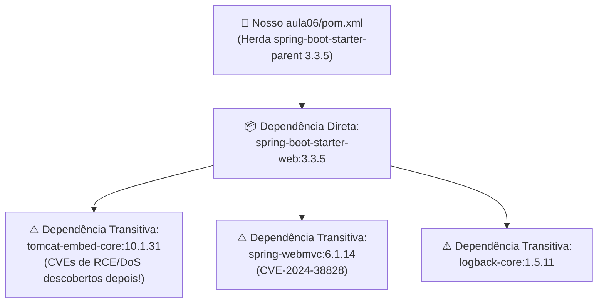

# Aula 06 — Consultas Seguras (SQL Injection), OWASP Top 10 & Tratamento Seguro de Exceções

**Prof. Wenceslau Neto · Ada Tech · Fundamentos de Segurança para Aplicações (BE-JV-013)**

---

## Slide 1 — 0. O Fio Condutor: Da Identidade para a Proteção do Código

> 🧭 **Onde estamos na jornada do módulo?**
> - **Aulas 03 a 05 (JWT, OAuth 2.0, SSO e OIDC):** Resolveram a pergunta **"QUEM é o usuário?"** (autenticação e autorização delegada).
> - **Hoje (Aula 06):** A pergunta muda para dentro do seu código Spring Boot:
>   1. **O que a sua API faz com o que RECEBE?** (Se ela confia demais no texto do usuário e concatena no SQL → **SQL Injection**).
>   2. **O que a sua API conta quando algo dá ERRADO?** (Se ela revela demais e devolve *stack trace* ou mensagem do banco → **Vazamento de Informação**).



---

## Slide 2 — 1. SQL Injection: Quando o Dado Vira Comando

> 🎬 **Imagine o cenário:** Um sistema interno tem uma tela de busca de alunos pelo nome. Alguém curioso digita no campo de busca:
> `x' OR '1'='1`
> A tela, que deveria retornar zero ou um aluno, **lista a tabela inteira do banco de dados**! Ninguém invadiu o servidor por SSH: a própria aplicação entregou os dados.

### O que é SQL Injection?
- É o ataque em que o invasor **altera a estrutura lógica da consulta SQL** injetando comandos dentro de um dado de entrada que a aplicação concatena sem tratar.
- **É exatamente o mesmo princípio do XSS (Aula 01), só que em outra fronteira:**
  - **No XSS:** Um **dado** do usuário vira **código JavaScript** no navegador.
  - **No SQL Injection:** Um **dado** do usuário vira **comando SQL** no banco de dados!

### O Código Vulnerável (`AlunoRepository.java` em `aula06`)

```java
// ❌ VULNERÁVEL a SQL Injection: o texto recebido é concatenado diretamente na consulta!
public List<Aluno> pesquisaVulneravel(String nome) {
    String sql = "SELECT * FROM alunos WHERE nome = '" + nome + "'";
    return jdbc.query(sql, MAPPER);
}
```

Quando o usuário envia `nome = x' OR '1'='1`, veja a String que é montada e enviada ao banco H2:

```sql
SELECT * FROM alunos WHERE nome = 'x' OR '1'='1'
```

- Como `'1'='1'` é **sempre verdadeiro (`TRUE`)**, a condição `WHERE` inteira passa a ser verdadeira para **todas as linhas da tabela**!
- *(Imagine se a query fosse `SELECT * FROM usuarios WHERE login = '...' AND senha = '...'` — o atacante faria login como o primeiro usuário da tabela, geralmente o `admin`, sem saber a senha!)*

---

## Slide 3 — 1. A Correção Definitiva: Instruções Preparadas (`PreparedStatement`)

```java
// ✅ CORRIGIDO: instrução preparada (PreparedStatement).
// O comando SQL e o dado seguem por caminhos separados!
public List<Aluno> pesquisa(String nome) {
    return jdbc.query("SELECT * FROM alunos WHERE nome = ?", MAPPER, nome);
}
```

### Por que o `?` (`PreparedStatement`) bloqueia qualquer SQL Injection?
Muitos acham que o `PreparedStatement` apenas "escapa aspas". O que acontece no protocolo do banco é muito mais forte:
1. **Fase 1 — Compilação do Comando (*Prepare*):** O banco recebe `SELECT * FROM alunos WHERE nome = ?` e compila a **Árvore Sintática (AST)** da consulta **antes** de conhecer o valor. A estrutura do `WHERE` está **trancada**.
2. **Fase 2 — Envio do Parâmetro (*Bind*):** O valor `x' OR '1'='1` é enviado separadamente como um **literal de texto puro**. Ele nunca passa pelo *parser* de comandos SQL! O banco simplesmente procura se existe algum aluno cujo nome completo seja literalmente `x' OR '1'='1` (e devolve `[]`).



---

## Slide 4 — 1. "Com JPA / Spring Data eu já estou protegido?" + O Caso do `LIKE`

> ⚠️ **Regra de Ouro:** Quem protege **NÃO é o framework (JPA/Hibernate)**; quem protege é a **parametrização**! Se você concatenar String dentro do JPA, o SQL Injection volta igualzinho!

| Forma de consultar no Spring / JPA | Situação | Por quê? |
| :--- | :--- | :--- |
| `JdbcTemplate` com `?` e valor passado à parte | ✅ **Segura** | Usa `PreparedStatement` no driver JDBC |
| Spring Data Derived Query: `findByUsername(String username)` | ✅ **Segura** | O Spring Data gera JPQL com parâmetro vinculado |
| `@Query("SELECT a FROM Aluno a WHERE a.nome = :nome")` (ou `?1`) | ✅ **Segura** | Usa *bind parameter* (`:nome` / `?1`) |
| `entityManager.createQuery("... WHERE a.nome = '" + nome + "'")` | ❌ **VULNERÁVEL!** | Concatenar texto com `+` em JPQL ou `createNativeQuery` permite injeção! |

### 🔍 E quando precisamos de busca parcial com `LIKE`? (Req `1.5` — UC4 do Projeto Final!)
- **Errado:** Colar o valor dentro da String SQL (`"SELECT * FROM alunos WHERE nome LIKE '%" + termo + "%'"`).
- **Certo (`AlunoRepository.pesquisaPorParteDoNome`):** Os sinais de `%` são colados ao **valor do argumento em Java**, enquanto o SQL continua usando apenas `?` (ou `:termo` no `@Query`):

```java
// ✅ Os '%' vão junto com o DADO no parâmetro; o SQL continua 100% parametrizado!
public List<Aluno> pesquisaPorParteDoNome(String termo) {
    return jdbc.query(
        "SELECT * FROM alunos WHERE LOWER(nome) LIKE LOWER(?)",
        MAPPER,
        "%" + termo + "%"
    );
}
```

### 🛡️ Defesa em Profundidade (Camadas Extras)
1. **E o ataque `x'; TRUNCATE TABLE alunos; --`?** Muitos drivers JDBC modernos bloqueiam *Stacked Queries* (múltiplos comandos separados por `;` na mesma chamada). Mas **isso não torna o código seguro**: o `OR '1'='1'` não usa `;` e já vazou o banco inteiro!
2. **Princípio do Menor Privilégio no Banco:** A conta usada pela aplicação web só deve ter permissão de `SELECT, INSERT, UPDATE, DELETE` nas tabelas de negócio — nunca permissão de `DROP TABLE` ou `TRUNCATE`.
3. **Validação de Entrada (`@Valid`) e WAF (Web Application Firewall):** Validar formato/tamanho na entrada e nunca expor erros de SQL na saída!

---

## Slide 5 — 2. Dependências Vulneráveis e o Caso Log4Shell (`CVE-2021-44228`)

> 💭 **Reflexão:** No módulo `aula06`, nós escrevemos **11 classes Java**. Mas quantas bibliotecas (`.jar`) escritas por terceiros estão rodando dentro da nossa aplicação?
> *(Quase 90% do código em execução vem de dependências! Uma falha numa biblioteca vira uma falha na **sua** aplicação).*

### 🔥 O Caso Mais Famoso: Log4Shell (`CVE-2021-44228` — Dezembro de 2021)
- Na biblioteca **Apache Log4j 2**, usada por milhões de sistemas Java no mundo todo, registrar no log um texto controlado pelo usuário (como um cabeçalho HTTP `User-Agent` ou um campo de busca) contendo uma expressão JNDI fazia o servidor **conectar num servidor do atacante, baixar uma classe maliciosa e executá-la remotamente (RCE)**!
- **Nuance importante para quem usa Spring Boot:**
  - O Spring Boot usa por padrão o **Logback** (`spring-boot-starter-logging`), e **NÃO** o Log4j 2!
  - Uma aplicação Spring Boot só era afetada se a equipe tivesse trocado explicitamente o log para Log4j 2 ou se alguma outra dependência o trouxesse transitivamente.
  - **A lição:** Você precisa saber exatamente o que está dentro da árvore do seu projeto!

### 🛠️ As 3 Ferramentas de Defesa no Ecossistema Maven / GitHub

1. **Scanner da própria IDE (IntelliJ IDEA Ultimate Package Checker):**
   - Sublinha em amarelo no `pom.xml` dependências que trazem **vulnerabilidades transitivas (CVEs)**.
2. **Enxergar a árvore completa de dependências (diretas e transitivas):**
   ```bash
   mvn -pl aula06 dependency:tree
   ```
3. **Cruzar com bases públicas de vulnerabilidades (CVEs / NVD) e automatizar com Dependabot:**
   ```bash
   mvn org.owasp:dependency-check-maven:check
   ```

---

## Slide 5B — 2. Estudo de Caso ao Vivo no Nosso `pom.xml`: Corrigindo Vulnerabilidades Transitivas!

> 🔍 **Olhem para o nosso `aula06/pom.xml` aberto no IntelliJ:**
> O IntelliJ mostra um alerta amarelo em `<artifactId>spring-boot-starter-web</artifactId>`:
> *"Provides transitive vulnerable dependency `org.apache.tomcat.embed:tomcat-embed-core:10.1.31` / `org.springframework:spring-webmvc:6.1.14`"*



### Por que isso aconteceu se nós não declaramos o Tomcat no `pom.xml`?
- **Dependência Direta vs. Transitiva:** Nós pedimos apenas o `spring-boot-starter-web` (direta), mas ele trouxe automaticamente dezenas de bibliotecas por baixo dos panos (transitivas), na versão congelada de quando o Spring Boot `3.3.5` foi lançado!

### 🛠️ As 2 Formas Profissionais de Corrigir no Maven / Spring Boot

#### Opção 1 — Correção Cirúrgica via `<properties>` (Quando você NÃO pode atualizar o Spring Boot inteiro agora)
O `spring-boot-dependencies` controla a versão de cada biblioteca interna por propriedades. Se saiu um CVE crítico só no Tomcat e a sua empresa ainda não pode atualizar o Spring Boot inteiro, você sobrescreve **apenas a propriedade do Tomcat** no `pom.xml`:

```xml
<properties>
    <!-- Atualiza cirurgicamente apenas o Tomcat embutido sem mexer no resto do Spring! -->
    <tomcat.version>10.1.39</tomcat.version>
</properties>
```
*(Em projetos Maven sem Spring Boot, usa-se a tag `<dependencyManagement>` para forçar a versão segura da dependência transitiva).*

#### Opção 2 — Atualizar o `<parent>` do Spring Boot (A Correção Completa e Recomendada!)
No [`pom.xml` raiz](../pom.xml), subimos a versão do `spring-boot-starter-parent` para a versão de correção (*patch/minor*) mais recente:

```xml
<parent>
    <groupId>org.springframework.boot</groupId>
    <artifactId>spring-boot-starter-parent</artifactId>
    <!-- De 3.3.5 para uma versão atualizada que já traz Tomcat, Spring MVC e Logback corrigidos! -->
    <version>3.4.5</version>
    <relativePath/>
</parent>
```
> ✅ **Regra de Engenharia:** Sempre rode `mvn test` após atualizar dependências para garantir que o upgrade de segurança não quebrou nenhum comportamento da aplicação!

---

## Slide 6 — 2. O OWASP Top 10 Conectado ao Nosso Módulo

A **OWASP (*Open Worldwide Application Security Project*)** publica periodicamente o ranking dos **10 maiores riscos de segurança em aplicações web**. Veja como o nosso módulo e a **API de Chamados** cobrem a lista:

| Posição (OWASP 2021) | Categoria | Onde aparece no nosso módulo / Projeto Final |
| :--- | :--- | :--- |
| **A01:2021** | **Broken Access Control** *(Controle de Acesso Quebrado — #1 da lista!)* | **Regra de propriedade da API de Chamados:** um usuário autenticado só vê/altera os **próprios** chamados (tentar acessar o de outro devolve `404`/`403`) |
| **A02:2021** | **Cryptographic Failures** *(Falhas Criptográficas)* | HTTPS/TLS (Aula 02), **Hash de senha com BCrypt** (nunca texto puro!) e assinatura do JWT com segredo em variável de ambiente (Aulas 03 e 07) |
| **A03:2021** | **Injection** *(Injeção)* | **XSS** (Aula 01) e **SQL Injection** resolvido com consultas parametrizadas (Hoje — Aula 06!) |
| **A06:2021** | **Vulnerable and Outdated Components** *(Componentes Vulneráveis)* | Auditoria com `mvn dependency:tree`, OWASP Dependency-Check e Dependabot (Hoje — Aula 06!) |
| **A07:2021** | **Identification and Authentication Failures** *(Falhas de Autenticação)* | Validação rigorosa de JWT (`exp`, assinatura), OAuth 2.0/PKCE e **Spring Security** (Aula 07) |

---

## Slide 7 — 3. Exceções: O Que a Sua API Revela Quando Algo Dá Errado?

Uma **exceção** em Java é um objeto que representa um evento inesperado durante a execução. Do ponto de vista de **Segurança de Aplicações**, existem **3 Critérios Obrigatórios** para tratar exceções:

1. **Todas as exceções devem ser detectadas e tratadas.**
2. **O sistema NUNCA deve ficar num estado inseguro (*Fail Secure* / *Fail Closed*).**
3. **Nenhuma resposta de erro enviada ao cliente deve divulgar informações sigilosas ou detalhes internos.**

### 🔐 Critério 2 na Prática: Falhar para o Lado Seguro (*Fail Secure*)
Imagine que o banco de dados caiu exatamente no momento em que o usuário tentou fazer login:

```java
// ❌ PROIBIDO (Fail Open): em caso de erro técnico, acaba liberando o acesso!
boolean autenticarInseguro(String usuario, String senha) {
    try {
        return repositorio.conferirCredenciais(usuario, senha);
    } catch (Exception e) {
        return true; // "Não deu para checar no banco, então deixa entrar!" -> PORTA ABERTA!
    }
}

// ✅ CORRETO (Fail Secure): em caso de falha, NEGA o acesso e registra no log do servidor!
boolean autenticarSeguro(String usuario, String senha) {
    try {
        return repositorio.conferirCredenciais(usuario, senha);
    } catch (DataAccessException e) {
        log.error("Falha ao consultar credenciais no banco", e);
        return false; // Na dúvida ou na falha, o acesso é SEMPRE negado!
    }
}
```

### 🗺️ Critério 3 na Prática: Por que *Stack Trace* na Resposta HTTP é um Mapa para o Atacante?
Uma resposta de erro com *stack trace* entrega de bandeja: **qual banco você usa** (`H2`, `PostgreSQL`), **nomes de tabelas e colunas**, **versão exata do Spring Boot/Hibernate** (para o atacante buscar CVEs daquela versão!) e **caminhos de pacotes internos**.

| Destinatário | O que DEVE receber | O que NUNCA deve receber |
| :--- | :--- | :--- |
| **Quem chamou a API (Cliente HTTP)** | Mensagem **curta, amigável e genérica** + **Status HTTP semântico** (`400`, `404`, `429`, `500`) | *Stack trace*, nomes de classes (`IllegalStateException`), URLs JDBC ou comandos SQL |
| **O Log do Servidor (`log.error`)** | O **detalhe técnico completo** (*stack trace* e contexto) que só a equipe de engenharia vê | Senhas em texto puro ou tokens de acesso válidos |

---

## Slide 8 — 3. Exceção Própria: Dando Nome e Semântica ao Erro

### O Problema do `.get()` Cego (`500` em vez de `404`)
Se o serviço fizer `repository.findById(id).get()` e o aluno `999` não existir, o `Optional` vazio lança `NoSuchElementException`, que vira um **`500 Internal Server Error`**.
- Mas um aluno que não existe **não é um defeito do servidor (`500`)** — é um recurso não encontrado (**`404 Not Found`**)!

### A Solução (`AlunoNaoEncontradoException.java` + `AlunoService.java`)

```java
// 1. Criamos uma exceção de domínio que dá nome claro à situação de negócio:
public class AlunoNaoEncontradoException extends RuntimeException {
    public AlunoNaoEncontradoException(Long id) {
        super("Aluno " + id + " não encontrado");
    }
}

// 2. No AlunoService, trocamos o .get() por .orElseThrow():
public Aluno buscaPorId(Long id) {
    return repository.findById(id)
            .orElseThrow(() -> new AlunoNaoEncontradoException(id));
}
```

> 💭 **Pergunta Rápida para a Turma — Qual Status HTTP Usar?**
> 1. O aluno `999` não existe no banco? → **`404 Not Found`**
> 2. O cliente mandou um JSON com `nome` de 2 letras ou faltou um cookie obrigatório? → **`400 Bad Request`**
> 3. O usuário errou a senha ou não mandou o token JWT? → **`401 Unauthorized`** *(Não autenticado)*
> 4. O usuário está logado, mas tentou acessar um recurso de administrador (ou de outro usuário)? → **`403 Forbidden`** *(ou `404` quando queremos esconder até a existência do registro de outra pessoa!)*
> 5. O cliente fez 2 chamadas seguidas e estourou o limite do Rate Limiter? → **`429 Too Many Requests`**
> 6. O banco de dados caiu inesperadamente? → **`500 Internal Server Error`** *(com mensagem genérica!)*

---

## Slide 9 — 4. Tratamento de Exceções no Spring (`@ExceptionHandler` vs. `@RestControllerAdvice`)

O Spring permite tirar os blocos `try-catch` repetitivos de dentro dos controllers em **dois níveis**:

### Nível 1: Local no Controller (`@ExceptionHandler`)
Vale **apenas** para as rotas daquele Controller (está comentado no final de [`AlunoController.java`](../aula06/src/main/java/com/ada/seguranca/aluno/AlunoController.java#L62-L65)):

```java
@ExceptionHandler(AlunoNaoEncontradoException.class)
public ResponseEntity<String> naoEncontrado(AlunoNaoEncontradoException ex) {
    return ResponseEntity.status(HttpStatus.NOT_FOUND).body(ex.getMessage());
}
```

### Nível 2: Global e Padronizado (`@RestControllerAdvice` + `ErroResponse`)
Um **único componente** intercepta as exceções de **todos os controllers da aplicação** e devolve sempre o mesmo contrato JSON ([`ErroResponse.java`](../aula06/src/main/java/com/ada/seguranca/exception/ErroResponse.java) — exatamente o formato exigido na Seção 09 da **API de Chamados**!):

```java
public record ErroResponse(int status, String erro, String mensagem, Instant timestamp) {
}
```

Exemplo de resposta JSON padronizada (`GET /alunos/999` → **Req `2.2`**):
```json
{
  "status": 404,
  "erro": "Not Found",
  "mensagem": "Aluno 999 não encontrado",
  "timestamp": "2026-11-11T19:30:00.123Z"
}
```

---

## Slide 10 — 4. Por Dentro do `GlobalExceptionHandler` e Suas 3 Regras de Ouro

Abra [`GlobalExceptionHandler.java`](../aula06/src/main/java/com/ada/seguranca/exception/GlobalExceptionHandler.java):

```java
@RestControllerAdvice
public class GlobalExceptionHandler extends ResponseEntityExceptionHandler {

    private static final Logger log = LoggerFactory.getLogger(GlobalExceptionHandler.class);

    // 1. Exceção de domínio -> 404 Not Found
    @ExceptionHandler(AlunoNaoEncontradoException.class)
    public ResponseEntity<ErroResponse> naoEncontrado(AlunoNaoEncontradoException ex) {
        return resposta(HttpStatus.NOT_FOUND, ex.getMessage());
    }

    // 2. Rate Limiter (Resilience4j) -> 429 Too Many Requests
    @ExceptionHandler(RequestNotPermitted.class)
    public ResponseEntity<ErroResponse> muitasRequisicoes(RequestNotPermitted ex) {
        return resposta(HttpStatus.TOO_MANY_REQUESTS,
                "Muitas requisições. Tente novamente em instantes.");
    }

    // 3. REDE DE SEGURANÇA: detalhe técnico vai SÓ para o log; cliente vê frase genérica!
    @ExceptionHandler(Exception.class)
    public ResponseEntity<ErroResponse> inesperado(Exception ex) {
        log.error("Erro inesperado", ex);
        return resposta(HttpStatus.INTERNAL_SERVER_ERROR,
                "Erro interno. Tente novamente mais tarde.");
    }
```

### 🚨 A Armadilha Clássica do `@ExceptionHandler(Exception.class)`!
- **O que acontece se o `GlobalExceptionHandler` NÃO estender `ResponseEntityExceptionHandler`?**
  - O método `@ExceptionHandler(Exception.class)` captura **qualquer `Exception`**, inclusive as exceções internas que o próprio **Spring MVC** lança quando o cliente faz uma requisição errada (como esquecer o cookie obrigatório em `GET /boas-vindas/estrito`, mandar JSON malformado ou método HTTP errado)!
  - Resultado do bug: um erro **`400 Bad Request`** do cliente é engolido pelo handler genérico e vira **`500 Internal Server Error`**!
- **A Correção:**
  - Fazer a classe estender **`ResponseEntityExceptionHandler`** e sobrescrever `handleExceptionInternal` (e `handleMethodArgumentNotValid` para o `@Valid`). Assim, o Spring MVC mantém os status corretos (`400`, `404`, `405`, `415`) e todos saem no formato `ErroResponse`!

---

## Slide 11 — 4. Fluxo Completo da Demo de Exceções (Postman `2.1` a `2.7`)

```mermaid
sequenceDiagram
    autonumber
    actor P as Postman / Cliente
    participant C as Controller
    participant H as GlobalExceptionHandler (@RestControllerAdvice)
    participant L as Log do Servidor (Console)

    Note over P,L: [Req 2.2] Exceção de Domínio (GET /alunos/999)
    P->>C: GET /alunos/999
    C->>H: throw new AlunoNaoEncontradoException(999)
    H-->>P: 404 Not Found -> {"status":404,"erro":"Not Found","mensagem":"Aluno 999 não encontrado"}

    Note over P,L: [Req 2.3] Rede de Segurança (GET /erro-teste)
    P->>C: GET /erro-teste
    C->>H: throw new IllegalStateException("... jdbc:h2:mem:testdb (usuário=sa) ...")
    H->>L: log.error("Erro inesperado", ex) [Stack trace fica SÓ no servidor!]
    H-->>P: 500 Internal Server Error -> {"status":500,"mensagem":"Erro interno. Tente novamente mais tarde."}

    Note over P,L: [Req 2.4] A Armadilha do Handler Genérico (GET /boas-vindas/estrito sem cookie)
    P->>C: GET /boas-vindas/estrito (sem Cookie: user-id)
    C->>H: Spring MVC lança MissingRequestCookieException
    Note right of H: Graças a "extends ResponseEntityExceptionHandler",<br/>o status 400 é preservado no formato ErroResponse!
    H-->>P: 400 Bad Request -> {"status":400,"erro":"Bad Request","mensagem":"Requisição inválida."}

    Note over P,L: [Req 2.5] Rate Limiter (2ª chamada seguida a GET /alunos em < 10s)
    P->>C: GET /alunos (2ª vez em < 10s)
    C->>H: Resilience4j lança RequestNotPermitted
    H-->>P: 429 Too Many Requests -> {"status":429,"mensagem":"Muitas requisições. Tente novamente em instantes."}

    Note over P,L: [Req 2.6] Bean Validation @Valid (POST /alunos com JSON inválido)
    P->>C: POST /alunos {"nome":"Oi", "email":"email-invalido"}
    C->>H: Spring lança MethodArgumentNotValidException
    H-->>P: 400 Bad Request -> {"status":400,"mensagem":"Campos inválidos: email (...); nome (...)"}
```

| Requisição na Coleção Postman | Status HTTP | `mensagem` no `ErroResponse` | Teste Automatizado em `Aula06Test` |
| :--- | :--- | :--- | :--- |
| **`2.2`** `GET /alunos/999` | `404` | `Aluno 999 não encontrado` | `alunoInexistenteDevolve404NoFormatoPadronizado` |
| **`2.3`** `GET /erro-teste` | `500` | `Erro interno. Tente novamente mais tarde.` | `erroInesperadoDevolveMensagemGenericaSemVazarDetalhes` |
| **`2.4`** `GET /boas-vindas/estrito` | `400` | `Requisição inválida.` | `erroDoSpringMvcMantemOStatus400EmVezDeVirar500` |
| **`2.5`** 2ª `GET /alunos` em < 10s | `429` | `Muitas requisições. Tente novamente em instantes.` | `segundaChamadaAoRateLimiterDevolve429Padronizado` |
| **`2.6`** `POST /alunos` inválido | `400` | `Campos inválidos: ...` | `validacaoDeEntradaDevolve400ComOsCamposInvalidos` |

---

## Slide 12 — 5. Para o Projeto Final: O Que Levar Hoje para a API de Chamados!

Hoje vocês já podem implementar **3 requisitos da rubrica** diretamente na **API de Chamados** usando o código da `aula06` como referência:

### 1️⃣ Tratamento Global no Formato da Seção 09 (`ErroResponse` + `GlobalExceptionHandler`)
- Copie o record `ErroResponse(status, erro, mensagem, timestamp)` e a estrutura do `GlobalExceptionHandler extends ResponseEntityExceptionHandler`.
- Crie a `ChamadoNaoEncontradoException` devolvendo `404` com `"Chamado {id} não encontrado."`.
- ⚠️ **Atenção para a Aula 07 (Spring Security):** O handler genérico de `Exception` não pode engolir as exceções de autenticação/autorização (`401`/`403`) e transformá-las em `500`!

### 2️⃣ Validação de Entrada com `@Valid` → `400 Bad Request` (Seção 08 e 09)
- Adicione `spring-boot-starter-validation` no `pom.xml` do projeto do grupo.
- Anote os DTOs (`titulo` de 5 a 100 caracteres, `descricao` até 2.000, `prioridade`, etc.) com `@NotBlank`, `@Size` e `@Valid` no Controller.
- Use a sobrescrita de **`handleMethodArgumentNotValid`** que está pronta no nosso [`GlobalExceptionHandler.java`](../aula06/src/main/java/com/ada/seguranca/exception/GlobalExceptionHandler.java#L49-L68) para informar quais campos falharam!

### 3️⃣ Busca por Título 100% Parametrizada (UC4) + Mapa de Ameaças (Seção 10)
- Implemente a busca parcial por título usando método derivado do Spring Data, `@Query` com `:titulo` ou `JdbcTemplate` com `?` (como em `pesquisaPorParteDoNome`). **Zero concatenação de String no SQL!**
- Já preencha no `README.md` do grupo as linhas do **Mapa de Ameaças**:
  - **SQL Injection:** onde fica a consulta de busca por título e como ela está parametrizada.
  - **Vazamento por mensagem de erro:** como o `GlobalExceptionHandler` esconde a *stack trace* na resposta HTTP e registra o erro apenas no log do servidor.
