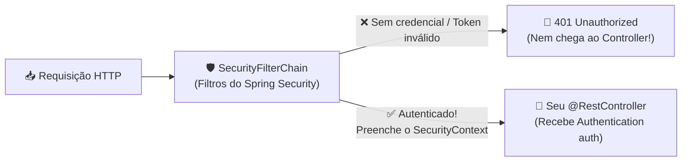

# Aula 07 — Protegendo uma API com Spring Security 6 & JWT Nativo

**Prof. Wenceslau Neto · Ada Tech · Fundamentos de Segurança para Aplicações (BE-JV-013)**

---

## Slide 1 — 1. Autenticação vs. Autorização e o Papel do Spring Security

> 🎬 **Imagine o cenário:** Na primeira versão da API de Chamados, qualquer pessoa na rede cria chamados em nome de qualquer colega. Na segunda versão, a equipe coloca login, mas salva a senha em texto puro no banco. Na terceira versão (hoje!), vamos fechar a porta da frente com **Spring Security 6**, **BCrypt** e **JWT**.

| Conceito | Pergunta que Responde | Exemplo Prático | Status HTTP quando falha |
| :--- | :--- | :--- | :--- |
| **Autenticação (*Authentication*)** | **"QUEM é você?"** | Usuário + senha (`Basic`) ou um token `JWT` válido | **`401 Unauthorized`** *(Não sei quem você é)* |
| **Autorização (*Authorization*)** | **"O QUE você pode fazer / ver?"** | Cada usuário só vê os **próprios** chamados (ou papel `ADMIN`) | **`403 Forbidden`** *(ou **`404 Not Found`** para esconder recursos de outros usuários!)* |

### Como o Spring Security Protege a Sua API?
Ele se posiciona **na frente** de todos os seus `@RestController` como uma **Cadeia de Filtros (`SecurityFilterChain`)**:



---

## Slide 2 — 1. As 5 Peças do Spring Security 6 (e a Abordagem 100% Nativa!)

| Peça do Spring Security | Qual é a responsabilidade dela? |
| :--- | :--- |
| **`SecurityFilterChain`** | Define as regras da porta da frente: quais rotas são públicas (`permitAll`), quais exigem login (`authenticated`), se há sessão (`STATELESS`) e quais mecanismos estão ativos (`httpBasic`, `oauth2ResourceServer`). |
| **`UserDetailsService`** | Interface de **1 único método** (`loadUserByUsername`) que ensina o Spring a buscar o usuário no seu banco de dados (`UsuarioRepository`). |
| **`PasswordEncoder`** | Faz o hash irreversível da senha com sal aleatório (**`BCryptPasswordEncoder`**) no cadastro e confere com `matches()` no login. |
| **`AuthenticationManager`** | Orquestra o login no `POST /authenticate`: chama o `UserDetailsService` + `PasswordEncoder` e lança `BadCredentialsException` se algo não bater. |
| **`JwtEncoder` & `JwtDecoder`** | Beans **nativos do Spring Security 6** (`spring-boot-starter-oauth2-resource-server`) que assinam e validam o token JWT sem precisar escrever filtro manual (`OncePerRequestFilter`) nem usar bibliotecas de terceiros! |

> 💡 **Spring Security 5 (Legado) × Spring Security 6 (Spring Boot 3):**
> - **Antigamente:** Estendia-se `WebSecurityConfigurerAdapter` (removido no Spring Security 6) e escrevia-se uma classe manual `JwtAuthenticationFilter extends OncePerRequestFilter` de 50 linhas fazendo `.substring(7)` no cabeçalho `Authorization`.
> - **Hoje (Spring Security 6 Nativo):** Declaramos um `@Bean SecurityFilterChain` com lambdas e ativamos `.oauth2ResourceServer(oauth2 -> oauth2.jwt(Customizer.withDefaults()))` — o próprio Spring faz todo o trabalho pesado!

---

## Slide 3 — 2. Por Que Senhas NUNCA Vão em Texto Puro (Nem em MD5/SHA-256)?

No cadastro (`POST /user`), apenas o **Hash BCrypt** vai para a tabela `users`:

```java
String hashBcrypt = passwordEncoder.encode(req.password());
// Exemplo gravado no banco:
// $2a$10$N9qo8uLOickgx2ZMRZoMyeIjZAgcfl7p92ldGxad68LJZdL17lhWy
```

| Forma de Guardar | O que acontece se o banco vazar? | É seguro para senhas? |
| :--- | :--- | :--- |
| **Texto Puro (`senha123`)** | O invasor lê todas as senhas imediatamente | ❌ **NUNCA!** |
| **Criptografia Reversível (`AES`)** | Quem roubar a chave descriptografa todas as senhas | ❌ **Não** (servidor não precisa saber a senha original, só conferir!) |
| **Hash Rápido (`MD5` / `SHA-256`)** | Uma GPU moderna testa **bilhões de combinações por segundo** (*Força Bruta* / *Rainbow Tables*) | ❌ **Não!** Rapidez é inimiga do armazenamento de senhas |
| **Hash Adaptativo Lento + Sal (`BCrypt` / `Argon2`)** | **1.** É **lento de propósito** (fator de custo `10`).<br/>**2.** Embute um **Sal (*Salt*) aleatório** em cada senha: duas pessoas com a mesma senha têm hashes totalmente diferentes! | ✅ **SIM! Padrão de mercado** |

---

## Slide 4 — 3. Live Coding Etapa 1: Entidade, `SecurityConfig` e Basic Auth (`1.1` a `1.5`)

### 1️⃣ Entidade `Usuario` e `UsuarioRepository` ([`Usuario.java`](../aula07/src/main/java/com/ada/seguranca/aula07/Usuario.java))
```java
@Entity
@Table(name = "users") // Atenção: "user" é palavra reservada no H2 e no PostgreSQL!
public class Usuario {
    @Id @GeneratedValue(strategy = GenerationType.IDENTITY)
    private Long id;

    @Column(unique = true, nullable = false)
    private String username;

    @Column(nullable = false)
    private String password; // Guarda SEMPRE o hash BCrypt ($2a$10$...)!
    // construtores e getters...
}
```

### 2️⃣ `UserDetailsService` em 5 Linhas no [`SecurityConfig.java`](../aula07/src/main/java/com/ada/seguranca/aula07/SecurityConfig.java)
Como `UserDetailsService` é uma `@FunctionalInterface`, não precisamos criar outra classe `.java`:
```java
@Bean
UserDetailsService userDetailsService(UsuarioRepository repo) {
    return username -> repo.findByUsername(username)
            .map(u -> User.withUsername(u.getUsername())
                    .password(u.getPassword())
                    .roles("USER")
                    .build())
            .orElseThrow(() -> new UsernameNotFoundException("Usuário não encontrado"));
}
```

### ⚠️ O Alcance e o Limite do HTTP Basic Auth (Req `1.5`)
- No **HTTP Basic**, o cliente envia `Authorization: Basic YW5hOnNlbmhhMTIz` (`base64("ana:senha123")`) **em todas as requisições**.
- **Base64 NÃO é criptografia** (qualquer um decodifica em 1 segundo). Só pode trafegar sobre **HTTPS**, obriga o cliente a guardar a senha e não tem expiração nativa. Por isso evoluímos para o **JWT**!

---

## Slide 5 — 4. Live Coding Etapa 2: JWT 100% Nativo no `SecurityConfig`!

Com o `spring-boot-starter-oauth2-resource-server`, adicionamos apenas os beans `JwtDecoder` e `JwtEncoder` e 1 linha na `SecurityFilterChain` ([`SecurityConfig.java`](../aula07/src/main/java/com/ada/seguranca/aula07/SecurityConfig.java)):

```java
@Bean
SecurityFilterChain filterChain(HttpSecurity http) throws Exception {
    return http
            .csrf(csrf -> csrf.disable())
            .sessionManagement(s -> s.sessionCreationPolicy(SessionCreationPolicy.STATELESS))
            .authorizeHttpRequests(auth -> auth
                    .requestMatchers(HttpMethod.GET, "/publico").permitAll()
                    .requestMatchers(HttpMethod.POST, "/user", "/authenticate").permitAll()
                    .anyRequest().authenticated()
            )
            .httpBasic(Customizer.withDefaults())
            // 🚀 Esta linha ativa o filtro nativo de JWT do Spring Security!
            .oauth2ResourceServer(oauth2 -> oauth2.jwt(Customizer.withDefaults()))
            .build();
}

@Bean
JwtDecoder jwtDecoder() {
    SecretKeySpec secretKey = new SecretKeySpec(jwtSecret.getBytes(StandardCharsets.UTF_8), "HmacSHA256");
    return NimbusJwtDecoder.withSecretKey(secretKey).macAlgorithm(MacAlgorithm.HS256).build();
}

@Bean
JwtEncoder jwtEncoder() {
    SecretKeySpec secretKey = new SecretKeySpec(jwtSecret.getBytes(StandardCharsets.UTF_8), "HmacSHA256");
    return new NimbusJwtEncoder(new ImmutableSecret<>(secretKey));
}
```

> 🔑 **Cuidado com a chave `JWT_SECRET`:**
> 1. **Nunca deixe a chave real fixa no código:** use `${JWT_SECRET}` vindo de variável de ambiente!
> 2. **Tamanho mínimo para `HS256`:** O algoritmo `HMAC-SHA256` exige uma chave de pelo menos **32 bytes (256 bits)**. Se a chave for curta (ex.: `"123"`), o `NimbusJwtEncoder` recusa assinar por insegurança!

---

## Slide 6 — 4. O Controller de Autenticação (`POST /user` e `POST /authenticate`)

Veja como [`AuthController.java`](../aula07/src/main/java/com/ada/seguranca/aula07/AuthController.java) fica limpo delegando tudo ao Spring:

```java
@PostMapping("/user")
public ResponseEntity<UsuarioCriadoResponse> cadastrar(@RequestBody LoginRequest req) {
    if (repo.findByUsername(req.username()).isPresent()) {
        throw new ResponseStatusException(HttpStatus.CONFLICT, "Nome de usuário já está em uso.");
    }
    Usuario salvo = repo.save(new Usuario(req.username(), passwordEncoder.encode(req.password())));
    return ResponseEntity.status(HttpStatus.CREATED)
            .body(new UsuarioCriadoResponse(salvo.getId(), salvo.getUsername()));
}

@PostMapping("/authenticate")
public TokenResponse autenticar(@RequestBody LoginRequest req) {
    // 1. O AuthenticationManager busca no banco e confere o BCrypt automaticamente!
    Authentication auth = authManager.authenticate(
            new UsernamePasswordAuthenticationToken(req.username(), req.password())
    );

    // 2. O JwtEncoder nativo gera e assina o token HS256 com expiração de 1h
    Instant agora = Instant.now();
    JwtClaimsSet claims = JwtClaimsSet.builder()
            .issuer("ada-aula07")
            .subject(auth.getName())
            .issuedAt(agora)
            .expiresAt(agora.plusSeconds(3600))
            .build();

    JwsHeader header = JwsHeader.with(MacAlgorithm.HS256).build();
    String token = jwtEncoder.encode(JwtEncoderParameters.from(header, claims)).getTokenValue();
    return new TokenResponse(token);
}
```

### 🛡️ Proteção Contra Enumeração de Usuários (Req `2.2` e `2.3`)
- Tanto para **usuário inexistente** quanto para **senha errada**, o `@ExceptionHandler(AuthenticationException.class)` devolve **`401 Unauthorized`** com a **exata mesma mensagem**: `"Usuário ou senha inválidos."` (assim um atacante não descobre quais usernames existem!).

---

## Slide 7 — 5. Por Que Desabilitar o CSRF Aqui É Seguro (e Quando NÃO Seria)?

Na `SecurityFilterChain`, escrevemos `.csrf(csrf -> csrf.disable())` e o README do Projeto Final exige **justificar** essa decisão:

| Cenário da Aplicação | Como a credencial viaja? | O navegador envia sozinho em ataques de outro site? | Deve habilitar CSRF? |
| :--- | :--- | :--- | :--- |
| **Aplicação Web com Sessão (`JSESSIONID`) ou JWT guardado em Cookie** | Cabeçalho `Cookie:` | **SIM!** O navegador anexa o cookie automaticamente se outro site disparar um `<form POST>` | ✅ **SIM! Obrigatório** (junto com `SameSite`) |
| **Nossa API REST Stateless (`Aula 07` / `API de Chamados`)** | Cabeçalho `Authorization: Bearer <token>` | **NÃO!** O navegador nunca preenche o cabeçalho `Authorization` sozinho | ✅ **Seguro desabilitar** (`csrf.disable()`), pois não usamos cookies! |

---

## Slide 8 — 6. A Regra de Propriedade: `404` para o Chamado de Outra Pessoa!

> 🏆 **Requisito #1 do OWASP Top 10 (*Broken Access Control*) no Projeto Final:**
> Autenticar sabe **quem é** o usuário (`ana` ou `carlos`). Mas na **API de Chamados**, cada pessoa **só pode ver ou alterar os chamados que ela mesma abriu**!

Veja as **3 Regras de Ouro** em [`ChamadoController.java`](../aula07/src/main/java/com/ada/seguranca/aula07/ChamadoController.java):

```java
@PostMapping
public ResponseEntity<Chamado> abrirChamado(@RequestBody NovoChamadoRequest req, Authentication auth) {
    // 1. A identidade do dono vem SEMPRE do token (auth.getName()), NUNCA do JSON enviado!
    Chamado novo = new Chamado(sequenciaId.getAndIncrement(), req.titulo(), req.descricao(), auth.getName());
    chamados.add(novo);
    return ResponseEntity.status(HttpStatus.CREATED).body(novo);
}

@GetMapping("/{id}")
public Chamado buscarPorId(@PathVariable Long id, Authentication auth) {
    // 2. Busca filtrando pelo ID **E** pelo dono autenticado ao mesmo tempo!
    // 3. Se pertencer a outro usuário, devolve 404 Not Found (e não 403) para não confirmar que o ID existe!
    return chamados.stream()
            .filter(c -> c.id().equals(id) && c.dono().equals(auth.getName()))
            .findFirst()
            .orElseThrow(() -> new ResponseStatusException(
                    HttpStatus.NOT_FOUND, "Chamado " + id + " não encontrado."
            ));
}
```

> 💡 **No Spring Data JPA (Projeto Final):** Basta declarar no `ChamadoRepository`:
> `Optional<Chamado> findByIdAndUsuarioUsername(Long id, String username);`

---

## Slide 9 — 7. Diagrama Completo da Demo no Postman (`1.1–1.5` e `2.1–2.9`)

```mermaid
sequenceDiagram
    autonumber
    actor P as Postman / Cliente
    participant SF as SecurityFilterChain<br/>(Basic + Native JWT)
    participant AC as AuthController
    participant CC as ChamadoController

    Note over P,CC: [Req 1.2 & 1.3] Sem token dá 401; Cadastro grava Hash BCrypt (201)
    P->>SF: GET /perfil (sem cabeçalho)
    SF-->>P: 401 Unauthorized
    P->>AC: POST /user {"username":"ana","password":"senha123"}
    AC-->>P: 201 Created {"id":1,"username":"ana"} (sem senha!)

    Note over P,CC: [Req 2.1 & 2.4] Login emite JWT HS256; Bearer Token libera acesso
    P->>AC: POST /authenticate {"username":"ana","password":"senha123"}
    AC-->>P: 200 OK {"token":"eyJhbGciOiJIUzI1NiJ9..."} (salvo em {{tokenAna}})
    P->>SF: GET /perfil (Authorization: Bearer {{tokenAna}})
    SF->>AC: Token válido! Authentication.getName() = "ana"
    AC-->>P: 200 OK {"usuarioAutenticado":"ana"}

    Note over P,CC: [Req 2.5 a 2.9] Regra de Propriedade: Ana cria #1; Carlos tenta ler #1 -> 404!
    P->>CC: POST /chamados (Bearer {{tokenAna}})
    CC-->>P: 201 Created -> Chamado #1 (dono = "ana")
    P->>CC: GET /chamados/1 (Bearer {{tokenCarlos}})
    Note right of CC: Filtra id==1 && dono=="carlos" -> Vazio!
    CC-->>P: 404 Not Found ("Chamado 1 não encontrado.")
```

---

## Slide 10 — 8. Checklist para a Próxima Aula (Laboratório do Projeto Final!)

Na **Aula 08**, teremos o laboratório prático para fechar a **API de Chamados**. Levem o código da `aula06` + `aula07` para o repositório do grupo cobrindo:

| Requisito da Especificação | Onde está o modelo no nosso repositório |
| :--- | :--- |
| **1. `SecurityConfig` com JWT + `BCrypt`** | [`aula07/.../SecurityConfig.java`](../aula07/src/main/java/com/ada/seguranca/aula07/SecurityConfig.java) |
| **2. `POST /user` (201/409) e `POST /authenticate` (200/401)** | [`aula07/.../AuthController.java`](../aula07/src/main/java/com/ada/seguranca/aula07/AuthController.java) |
| **3. Regra de Propriedade (`auth.getName()` + `404` para chamado alheio)** | [`aula07/.../ChamadoController.java`](../aula07/src/main/java/com/ada/seguranca/aula07/ChamadoController.java) |
| **4. `GlobalExceptionHandler` + `ErroResponse` + `@Valid`** | [`aula06/.../GlobalExceptionHandler.java`](../aula06/src/main/java/com/ada/seguranca/exception/GlobalExceptionHandler.java) |
| **5. Busca por título parametrizada (sem concatenação de SQL)** | [`aula06/.../AlunoRepository.java`](../aula06/src/main/java/com/ada/seguranca/aluno/AlunoRepository.java) |
